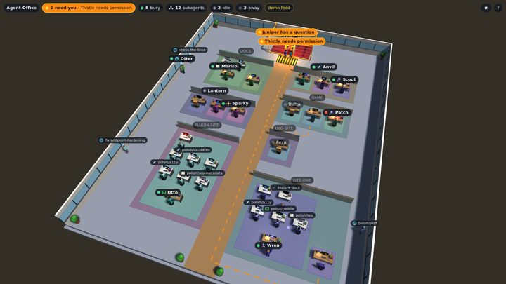
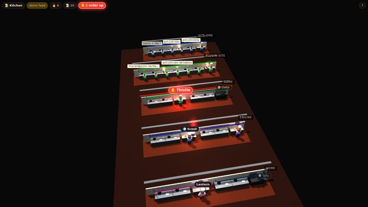
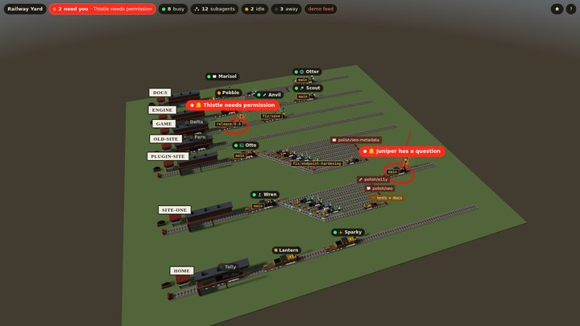
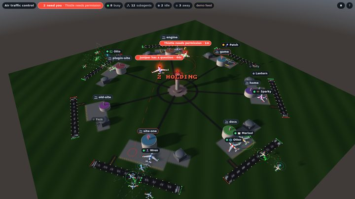
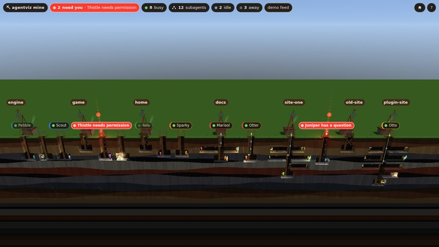
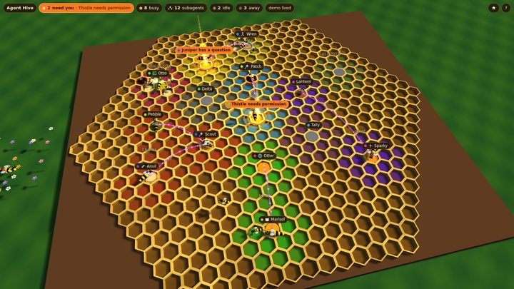
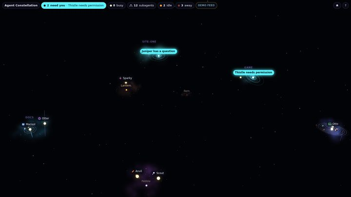
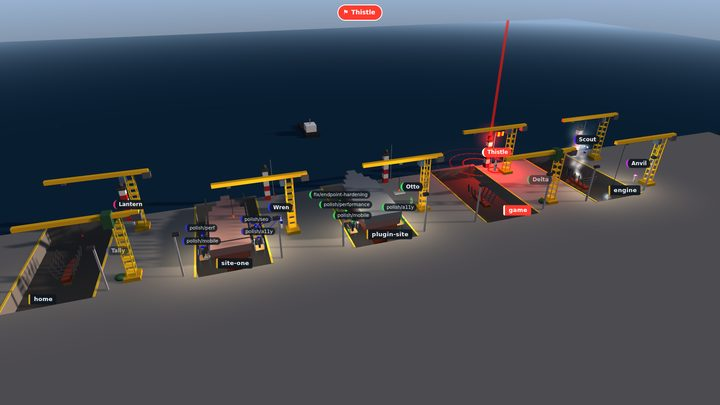
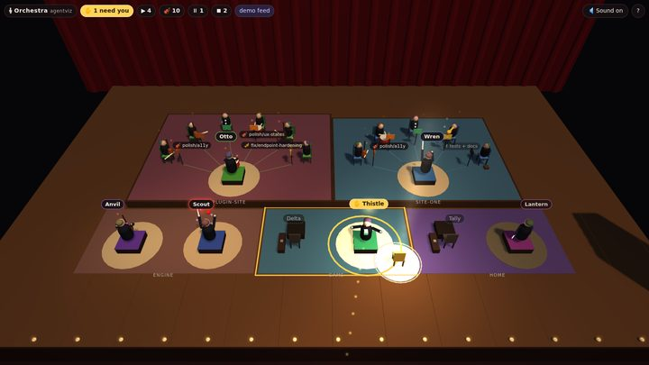
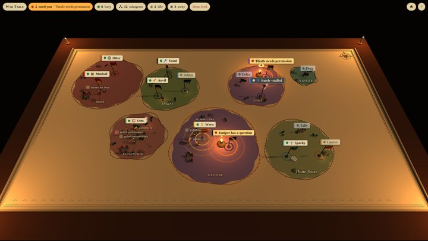

# agentviz

Ten ways to watch Claude Code sessions and their subagents at work, drawn
with [Strata](https://github.com/Preponderous-Software/strata), plus the
shared feed they all read.

Every visualization runs the same way, with Python 3.8+ and nothing to install:

```bash
git clone https://github.com/dmccoystephenson/agentviz-<name>
cd agentviz-<name>
python3 -m vendor.agentfeed serve --web web --port <port>            # live sessions
python3 -m vendor.agentfeed serve --web web --port <port> --fixture  # demo feed
```

then open `http://127.0.0.1:<port>/`. Live mode reads your local Claude Code
session files and shows names, states, tool names and short labels, never file
contents or commands; see [SECURITY.md](SECURITY.md).

## The visualizations

| # | Repo | Port | Metaphor | Sessions are… | Subagents are… |
|---|---|---|---|---|---|
| 1 | [agentviz-office](https://github.com/dmccoystephenson/agentviz-office) | 8841 | Open-plan office | lead desks in team pods (one pod per repo) | satellite desks in the pod; tool = desk activity; waiting = note on the owner's door |
| 2 | [agentviz-kitchen](https://github.com/dmccoystephenson/agentviz-kitchen) | 8842 | Restaurant kitchen | head chefs at the pass | line cooks at stations; tickets on the rail |
| 3 | [agentviz-railway](https://github.com/dmccoystephenson/agentviz-railway) | 8843 | Railway yard | trunk lines (branches) | locomotives on sidings; signals for state |
| 4 | [agentviz-atc](https://github.com/dmccoystephenson/agentviz-atc) | 8844 | Air traffic control | airports / gates | flights out and back; holding stack = waiting on you |
| 5 | [agentviz-mine](https://github.com/dmccoystephenson/agentviz-mine) | 8845 | Mine cross-section | shafts | branching tunnels; depth = time/tool calls |
| 6 | [agentviz-hive](https://github.com/dmccoystephenson/agentviz-hive) | 8846 | Beehive | queens' cells by repo | foragers; trails where repos overlap |
| 7 | [agentviz-constellation](https://github.com/dmccoystephenson/agentviz-constellation) | 8847 | Star system | stars | orbiting planets; speed = activity |
| 8 | [agentviz-shipyard](https://github.com/dmccoystephenson/agentviz-shipyard) | 8848 | Shipyard | hulls in dry dock (repos) | welders on scaffolding |
| 9 | [agentviz-orchestra](https://github.com/dmccoystephenson/agentviz-orchestra) | 8849 | Orchestra | conductors | instrument sections; tool calls play notes (opt-in audio) |
| 10 | [agentviz-wartable](https://github.com/dmccoystephenson/agentviz-wartable) | 8850 | Campaign war table | banners on regions | scouts riding out |

## Gallery

Hero shots from each repo's demo feed (`?fixture=1`). Each repo's README has the full set: close-ups of every state, the selected-agent panel, a phone shot and a short GIF.

| [**Office**](https://github.com/dmccoystephenson/agentviz-office) | [**Kitchen**](https://github.com/dmccoystephenson/agentviz-kitchen) |
|---|---|
| [](https://github.com/dmccoystephenson/agentviz-office)<br>Team pods round a corridor to the owner's glass office; waiting = sticky note on the owner's door | [](https://github.com/dmccoystephenson/agentviz-kitchen)<br>Head chefs at the pass, line cooks at stations; waiting = red heat lamp + service bell |
| [**Railway**](https://github.com/dmccoystephenson/agentviz-railway) | [**Air traffic control**](https://github.com/dmccoystephenson/agentviz-atc) |
| [](https://github.com/dmccoystephenson/agentviz-railway)<br>Locomotives on trunk lines, subagents on sidings; waiting = flashing red signal + bell | [](https://github.com/dmccoystephenson/agentviz-atc)<br>Aircraft at gates, subagents fly loops; waiting = holding stack round the owner's tower |
| [**Mine**](https://github.com/dmccoystephenson/agentviz-mine) | [**Hive**](https://github.com/dmccoystephenson/agentviz-hive) |
| [](https://github.com/dmccoystephenson/agentviz-mine)<br>Shafts in layered earth, subagent tunnels grow with work; waiting = red cage + flare at the collar | [](https://github.com/dmccoystephenson/agentviz-hive)<br>Bees on a hex comb, workers fly loops; waiting = alarm dance; shared repos joined by scent trails |
| [**Constellation**](https://github.com/dmccoystephenson/agentviz-constellation) | [**Shipyard**](https://github.com/dmccoystephenson/agentviz-shipyard) |
| [](https://github.com/dmccoystephenson/agentviz-constellation)<br>Stars with orbiting planets; waiting = pulsing beacon rings | [](https://github.com/dmccoystephenson/agentviz-shipyard)<br>Foremen and welders round growing hulls; waiting = foghorn lamp + flag |
| [**Orchestra**](https://github.com/dmccoystephenson/agentviz-orchestra) | [**War table**](https://github.com/dmccoystephenson/agentviz-wartable) |
| [](https://github.com/dmccoystephenson/agentviz-orchestra)<br>Conductors and musicians, action = instrument family, opt-in sound; waiting = spotlight on the solo chair | [](https://github.com/dmccoystephenson/agentviz-wartable)<br>Banners and scouts on a candlelit map; waiting = beacon fire on a hill |

All ten are built on the Strata 0.10.0 web kit and read agentfeed schema v1.

agentfeed began as the data half of an earlier session-village view, without
its layout.

## agentfeed

`agentfeed/` is a standard-library-only Python package, built as a pure core
behind two ports with one adapter per outside system. `build_feed()` turns
`~/.claude/sessions` + transcripts into the document in
[docs/FEED.md](docs/FEED.md); `python3 -m agentfeed serve` serves it next to a
visualization's `web/` dir.

## The shared kit

`kit/` is everything a visualization needs around its scene: the feed client
(polling, diffing, an explicit "unreachable" state), the HUD (the "needs you"
chip, the selected-agent panel and phone bottom sheet, the demo-feed badge,
the legend), world labels and tap picking, one page-to-engine data format
(`agentviz-wire.js` packs, `agentviz.h` decodes), the scene build and the
browser-test harness. See [docs/KIT.md](docs/KIT.md). Each visualization
vendors agentfeed and the kit with `tools/vendor-kit.sh <repo>` (it writes
`vendor/agentfeed/` and `vendor/agentviz-kit/`, each with a `PIN`, and copies
the page files into the repo's `web/`).

```bash
python3 -m agentfeed dump --fixture     # the demo feed
python3 -m agentfeed dump               # this machine, now
python3 -m unittest discover -s tests   # agentfeed, plus the kit's native header test (g++)
node --test tests/kit/*.test.js         # the kit's feed and wire unit tests
```

Building a scene: [docs/BUILDING.md](docs/BUILDING.md).

## Licence

Code: [MIT](LICENSE). Screenshots and GIFs in `docs/`: [CC0 1.0](LICENSE-media).
The visualizations bundle the Strata engine (MIT) and its third-party
libraries; each viz repo carries those notices.
